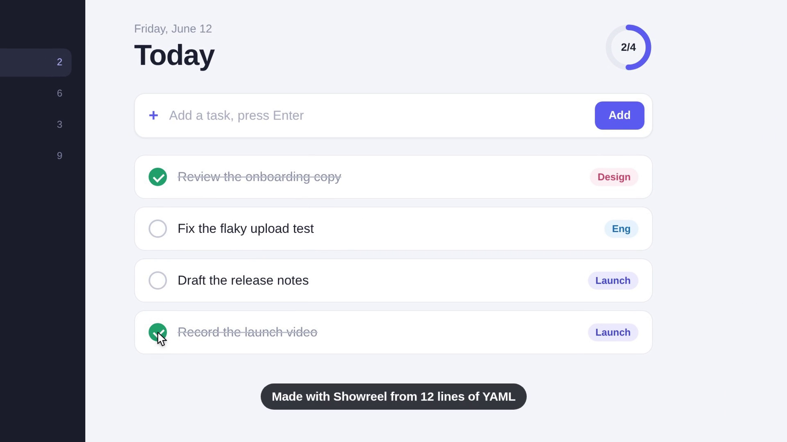
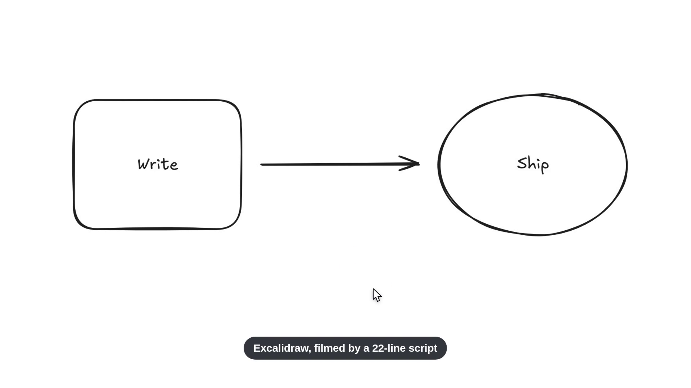

# Reelcam

**Cinematic demo videos of your web app, from a short YAML script.** A camera that frames what
matters and moves ahead of the action, a pointer that moves like a person, captions that never
cover the subject, and a check that fails the video when the camera crops it. Runs headless, in
CI, or by your coding agent.

[](docs/hero.mp4)

<sub>The video above (click for the MP4) was recorded by Reelcam from these 17 lines,
[`examples/hero.yml`](examples/hero.yml). The demo app, Orbit, is in [`examples/orbit`](examples/orbit).</sub>

```yaml
serve: orbit
viewport: { width: 1280, height: 720 }
steps:
  - wait: 200
  - click: "#search"
  - focus: { on: "#palette", why: "the typing happens inside the palette" }
  - type: { text: "ship 2.0", delay: 75 }
  - wait: 450
  - press: Enter
  - focus: { on: "#release", why: "the checks tick, the ring fills, it goes live" }
  - wait: 2600
  - wide: "the changelog is below the fold"
  - scroll: { to: "#changelog", ms: 1200 }
  - wait: 250
  - focus: { on: "#changelog", why: "the payoff: 2.0 lands in the changelog" }
  - caption: Recorded from 17 lines of YAML
  - wait: 1900
```

The same story as a 9:16 phone video, from [`examples/hero-vertical.yml`](examples/hero-vertical.yml):
[docs/hero-vertical.mp4](docs/hero-vertical.mp4).

### Gallery

| | |
|---|---|
| [](docs/gallery/excalidraw.mp4) | **Excalidraw** (MIT), built and run locally. A two-step flow sketched with the keyboard tools, filmed by [a 22-line script](examples/gallery/excalidraw/excalidraw.yml) with `drag`, a `setup` step and an `area` shot. |

Every video has a per-moment content audit in [docs/AUDIT.md](docs/AUDIT.md).

## Quickstart

Needs Node.js 22.12+ and ffmpeg.

<!-- quickstart:start -->
```sh
npm install --global reelcam
reelcam setup --with-deps
reelcam init --demo reelcam-demo
reelcam render reelcam-demo/demo.yml
```
<!-- quickstart:end -->

That records the bundled demo app and writes `out/demo.mp4` and `out/demo.sheet.png`, a
contact sheet with four stills per shot. (`--with-deps` also installs Chromium's system
libraries on Linux and may need `sudo`; on macOS and Windows plain `reelcam setup` is enough.)

For your own app: `reelcam init` writes a starter `reelcam.yml`. Point `url` at your app running
locally, or `serve` at a built folder, then `reelcam render reelcam.yml`.

## Why

- **Every move has a reason.** A shot frames a whole UI element, read from the DOM while it
  records. The camera cuts between shots on a critically damped spring, and it never chases the cursor.
- **It checks itself.** The render fails (exit 1) when a frame crops its subject (from 0.15 s after its cut), a shot
  flickers past in under 1.2 s, a click happens off camera, a caption covers the subject, or
  forbidden text (say `lorem` or `TODO`) appears on screen.
- **It is repeatable.** A script is code: review it in a PR, re-record it after every UI change,
  and render it in CI. The pointer's jitter is seeded.
- **It suits agents.** The [agent skill](skills/reelcam/SKILL.md) teaches a coding agent to film the
  feature it just built and check the contact sheet before reporting.
- **It is private by default.** It opens local URLs only unless you opt in, and `redact` blurs
  selectors before the first frame.

## Script format

| Key | Default | Meaning |
|---|---|---|
| `url` | | The page to open (local by default). Paths in `visit` resolve against it. |
| `serve` | | A folder to serve on 127.0.0.1, relative to the script. Use it instead of `url`, or with `url` as a path. |
| `title` | | A pill shown for the first 2 s. State the one idea of the video. |
| `viewport` | `{ width: 1440, height: 810 }` | The browser size in CSS px. |
| `scale` | `2` | Device pixel ratio of the recording (1 to 3). |
| `preset` | `studio` | The look (see Presets). |
| `colorScheme` | `light` | `light` or `dark`. |
| `redact` | `[]` | Selectors to blur in every frame. |
| `forbid` | `[]` | Regular expressions (case-insensitive) that fail the video if visible. |
| `allowRemote` | `false` | Allow non-local URLs. |
| `output` | `out/<name>.mp4` | Where to write the MP4, relative to the script. |
| `gif` | `false` | Also write a GIF. |
| `seed` | `1` | Seed for the pointer's human jitter. |
| `setup` | `[]` | Steps played before filming starts: sign in, dismiss a banner, give a canvas app keyboard focus. No camera steps. |
| `steps` | | The list below. |

| Step | Example | Does |
|---|---|---|
| `focus` | `focus: { on: "#form", why: "..." }` or `focus: "#form"` | Camera frames this element, whole, until the next camera step. |
| `focus` area | `focus: { area: [0.2, 0.3, 0.8, 0.7] }` | Camera frames a region of the page ([left, top, right, bottom] fractions), for canvas apps. |
| `zoom` | `zoom: { on: ".chart", level: 1.5 }` | Like `focus`, at most this zoom. |
| `wide` | `wide` or `wide: "why"` | Camera back to the whole page. |
| `click` | `click: "button:has-text('Save')"` or `click: { at: [0.5, 0.6] }` | Moves the pointer there and clicks, then eases off so the result shows. |
| `drag` | `drag: { from: [0.2, 0.4], to: "#bin", on: "canvas", ms: 600 }` | Press, move, release: draw, drag and drop. Points are selectors or fractions of `on` (default the page). |
| `hover` | `hover: ".menu"` | Moves the pointer there. |
| `type` | `type: { into: "#name", text: "Ada", delay: 45 }` | Clicks the field (if `into`) and types like a person. |
| `press` | `press: Enter` | Presses a key or chord (`Control+K`). |
| `scroll` | `scroll: 400` or `scroll: { to: "#pricing", ms: 900 }` | Eased wheel scroll. |
| `wait` | `wait: 1200` | Holds, in ms. |
| `waitFor` | `waitFor: ".toast"` | Waits until the element is visible (up to 10 s). |
| `visit` | `visit: /settings` | Opens another page. |
| `caption` | `caption: "Saved"` or `caption: { text: "Saved", ms: 2500 }` | A caption at the bottom; the camera leaves room for it. |

Selectors are [Playwright selectors](https://playwright.dev/docs/locators): CSS plus
`:has-text()`, `>> nth=1` and more. `reelcam check script.yml` validates a script and lists every
problem with its path, such as `steps[3].type.text: expected string`.

## Camera rules

1. A shot frames a **subject**, a whole element or a page area, with air on every side (it fills
   at most 88%). If the subject grows during the shot, the frame grows with it and never shrinks back.
2. Every move **starts 0.35 s ahead of the cut**, and the zoom is capped on the way so the next
   subject is whole from the first frame of its shot. Pulling out is quicker than pushing in.
3. Zoom in only when the subject is small and every beat that follows stays inside it. A zoom
   that gains less than 12% is skipped.
4. Lists, feeds, scrolling and search are shown wide: both the source and the result must be seen.
   A wide shot fills the frame when that crops only the stage margin.
5. While a shot holds, the camera **breathes**: a 3% push-in over 5 s.
6. Captions get room: for the whole shot the camera keeps the caption band clear of the subject
   (a wide shot pulls back, and a view may pass onto the stage below the page).
7. Every shot is held at least 1.2 s.
8. One idea per video: 6 to 15 s. Start on the view and end right after the payoff.

## Presets

| Name | Size | Look |
|---|---|---|
| `studio` | 1920x1080 | Dark indigo stage, rounded page with a soft shadow. |
| `daylight` | 1920x1080 | Light stage for light apps. |
| `bare` | 1920x1080 | No stage: the page fills the frame. |
| `vertical` | 1080x1920 | 9:16 for phone viewports (e.g. 390x844). |
| `square` | 1080x1080 | 1:1 for social feeds. |

A preset is a plain object in [`src/presets/index.ts`](src/presets/index.ts). It sets the canvas,
background, margin, radius, shadow, pointer, ripple colour, spring half-life, zoom limits and
caption style. New presets are welcome.

## GitHub Action

```yaml
- uses: actions/checkout@v4
- run: npm ci && (npm start &) && npx wait-on http://localhost:3000
- uses: gituseridk/reelcam@v0
  with:
    script: demos/signup.yml
```

It installs Chromium and ffmpeg, renders, fails the job when the video fails its checks, and
uploads the MP4 and contact sheet as an artifact. Inputs: `script`, `output`, `preset`, `gif`,
`allow-remote`, `upload`, `artifact-name`, `node-version`. Outputs: `video`, `sheet`, `gif`.

## CLI

```
reelcam render <script.yml> [-o out.mp4] [-p preset] [--gif] [--no-sheet] [--no-check] [--allow-remote] [--keep dir]
reelcam check <script.yml>
reelcam init [file] | reelcam init --demo [dir]
reelcam setup [--with-deps]
reelcam presets
```

Exit codes: 0 ok, 1 written but failed a check, 2 usage, 3 error. Logs go to stderr and the
written file paths to stdout.

## API

```ts
import { render } from 'reelcam';

const result = await render('demo.yml', { output: 'out/demo.mp4', gif: false });
if (result.problems.length > 0) console.error(result.problems);
```

## How it works

1. **Record.** Playwright opens the page in headless Chromium. A CDP screencast captures frames at
   device scale, with timestamps. A scripted actor moves a real mouse along eased, slightly curved
   paths. Every pointer position, click and shot is logged on the same clock, and each shot's
   subject box is re-measured every 100 ms.
2. **Render.** For each output frame the virtual camera springs toward the current shot's framing.
   The page is drawn onto the stage at that crop, and the pointer, ripples and captions are drawn
   crisp on top. Raw frames go to ffmpeg (H.264, `yuv420p`, fast start).
3. **Check.** Every settled frame is tested against the subject boxes, and a contact sheet is written.

## Development

```sh
npm ci
npx playwright install chromium
npm run check        # eslint (strict, type-checked) + tsc + vitest, including real renders
./scripts/hero.sh    # re-render the README videos (16:9 and 9:16)
./scripts/gallery.sh # build Excalidraw locally and film the gallery video
node scripts/rename.mjs <new-name> "<Display Name>"   # rename the project everywhere in one step
./scripts/fresh-install.sh   # run the Quickstart above in a clean container
```

## License

[Apache-2.0](LICENSE)
